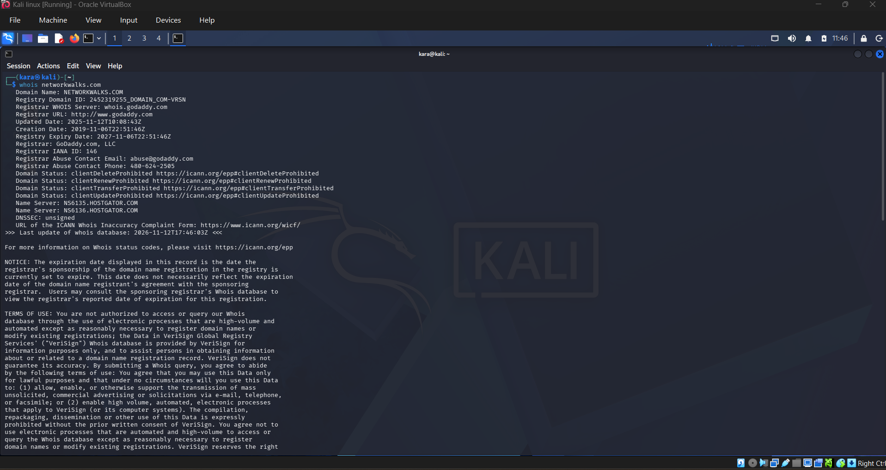
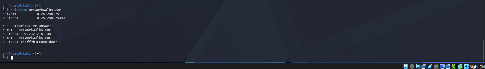
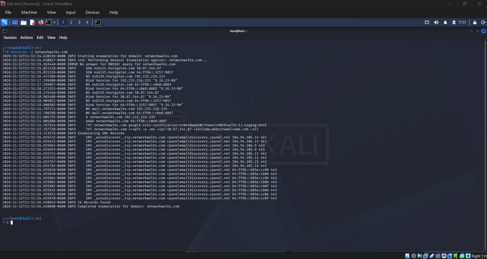
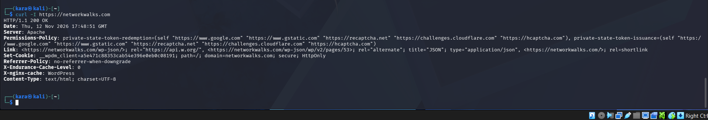
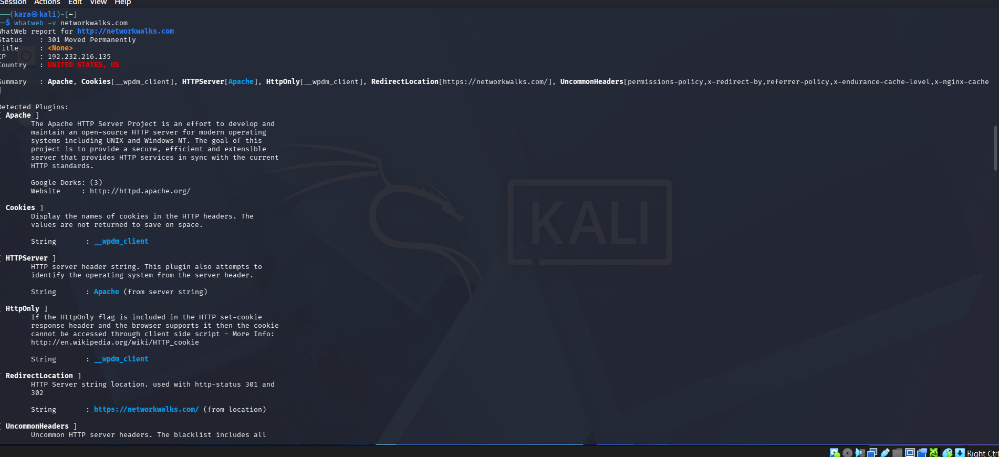
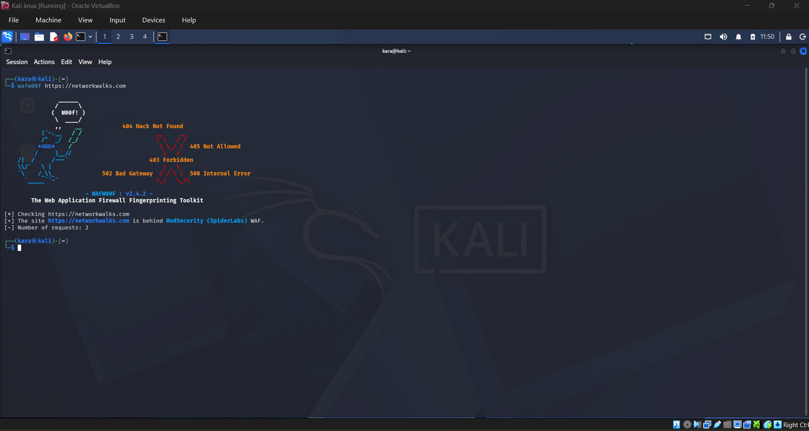
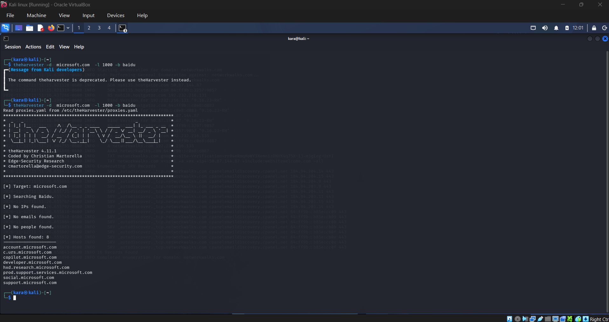
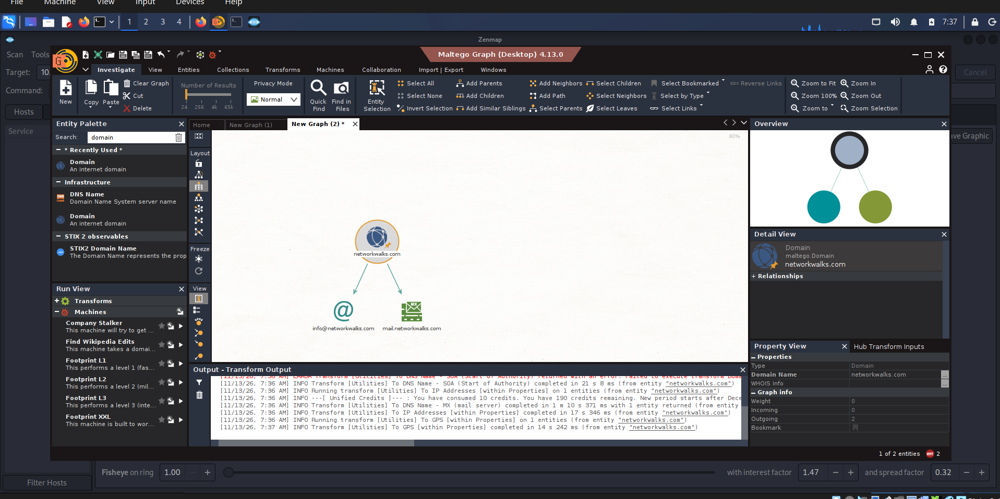
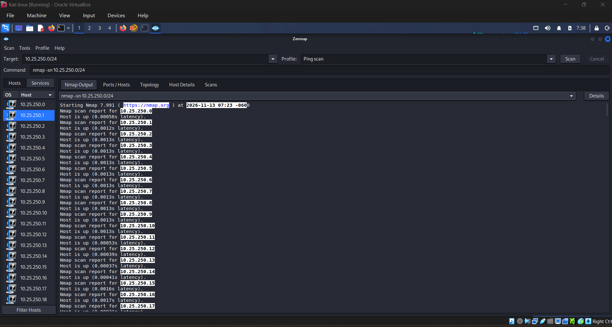
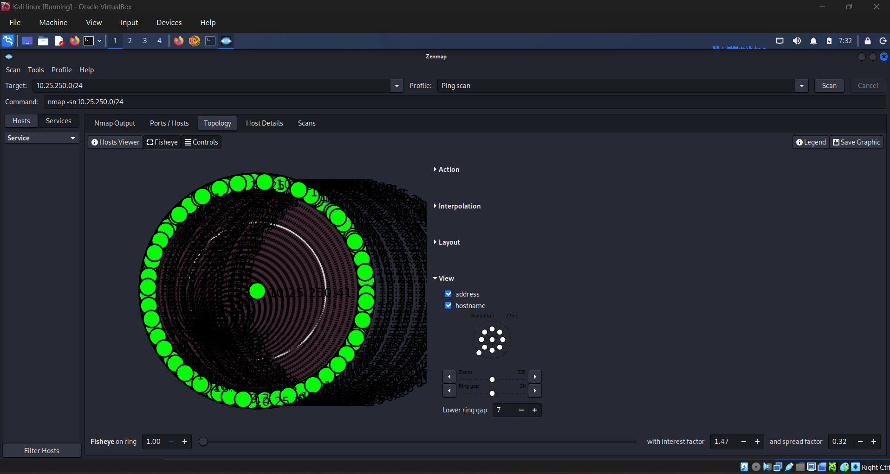

# 🛡️ WEEK 02 — FOOTPRINTING & NETWORK SCANNING REPORT

<div align="center">


<br/>


**WEEK 02 | CYBERSECURITY INTERNSHIP | NETWORKWALKS**

</div>

---

# 📑 TABLE OF CONTENTS

- [1. Project Overview](#-1-project-overview)
- [2. Objectives](#-2-project-objectives)
- [3. Scope and Authorization](#-3-scope-and-authorization)
- [4. Tools and Technologies](#-4-tools-and-technologies)
- [5. Methodology](#-5-methodology)
- [6. Practical Implementation](#-6-practical-implementation)
  - [6.1 WHOIS](#61-whois---domain-information)
  - [6.2 NSLookup](#62-nslookup---dns-resolution)
  - [6.3 DNSRecon](#63-dnsrecon---dns-enumeration)
  - [6.4 cURL](#64-curl---http-header-analysis)
  - [6.5 WhatWeb](#65-whatweb---web-technology-fingerprinting)
  - [6.6 WAFW00F](#66-wafw00f---waf-detection)
  - [6.7 TheHarvester](#67-theharvester---osint-enumeration)
  - [6.8 Maltego](#68-maltego---visual-link-analysis)
  - [6.9 Zenmap](#69-zenmap---network-scanning)
- [7. Findings and Observations](#-7-findings-and-observations)
- [8. Risk Analysis](#-8-risk-analysis)
- [9. Security Recommendations](#-9-security-recommendations)
- [10. Practical Evidence](#-10-practical-evidence)
- [11. Key Learnings](#-11-key-learnings)
- [12. Conclusion](#-12-conclusion)
- [13. Disclaimer](#-13-disclaimer)

---

# 🎯 1. PROJECT OVERVIEW

This project documents practical activities performed during **Week 02 of my Cybersecurity Internship at Networkwalks**.

The primary objective of this project is to understand how reconnaissance, footprinting, Open Source Intelligence (OSINT), and network scanning techniques are used during the initial phases of a security assessment.

The project combines multiple Kali Linux reconnaissance tools, graphical intelligence analysis using Maltego, and network discovery using Zenmap.

Instead of simply executing commands, the focus is on understanding the information collected, interpreting the results, identifying potential security exposure, and documenting observations.

### 📌 Project Information

| Field | Details |
|---|---|
| Project | Week 02 - Footprinting & Network Scanning |
| Organization | Networkwalks |
| Internship | Cybersecurity & Ethical Hacking |
| Author | OMxploit |
| Platform | Kali Linux |
| Primary Target | networkwalks.com |
| Network Scanning Scope | Authorized local network |
| Project Status | In Progress |
| Assessment Type | Reconnaissance & Network Discovery |

# 🎯 2. PROJECT OBJECTIVES

The main objectives of this practical project are:

- 🔍 Understand passive and active footprinting techniques.
- 🌐 Collect publicly available domain information.
- 📧 Identify publicly indexed email addresses and subdomains.
- 🧠 Understand OSINT relationships using Maltego.
- 🖥️ Identify website technologies and web server information.
- 🛡️ Understand Web Application Firewall detection.
- 📡 Understand DNS records and domain infrastructure.
- 🔎 Discover live hosts within an authorized local network.
- 🗺️ Visualize network relationships and topology using Zenmap.
- 📄 Prepare a structured technical security assessment report.

# 🔐 3. SCOPE AND AUTHORIZATION

The practical activities are divided into two major areas:

**A. Domain Footprinting**

- Target domain: `networkwalks.com`
- Information gathering using Kali Linux tools.
- Website technology identification.
- DNS and HTTP information analysis.
- OSINT-based reconnaissance.

**B. Network Scanning**

- Authorized local network.
- Identification of local IP address and subnet.
- Live host discovery.
- Network mapping and topology visualization.

All testing must remain within the scope approved for the internship. Network scanning is limited to the authorized local network.

# 🧰 4. TOOLS AND TECHNOLOGIES

| Tool | Purpose |
|---|---|
| Kali Linux | Penetration testing environment |
| WHOIS | Domain registration information |
| NSLookup | DNS resolution |
| DNSRecon | DNS record enumeration |
| cURL | HTTP response and header analysis |
| WhatWeb | Website technology fingerprinting |
| WAFW00F | Web Application Firewall detection |
| TheHarvester | OSINT and email/subdomain discovery |
| Maltego | Visual intelligence and relationship analysis |
| Zenmap | Graphical network scanning |
| Nmap | Network discovery and port scanning |

# ⚙️ 5. METHODOLOGY

The project follows a structured reconnaissance and scanning workflow.

```text
             START
               |
               v
       TARGET IDENTIFICATION
               |
               v
       DOMAIN FOOTPRINTING
               |
       +-------+--------+
       |       |        |
       v       v        v
     WHOIS   DNS      WEB
           ENUMERATION ANALYSIS
       |       |        |
       +-------+--------+
               |
               v
        OSINT INFORMATION
               |
       +-------+--------+
       |                |
       v                v
  THEHARVESTER        MALTEGO
       |                |
       +-------+--------+
               |
               v
       NETWORK DISCOVERY
               |
               v
             ZENMAP
               |
               v
       FINDINGS & ANALYSIS
               |
               v
          FINAL REPORT
```

# 🔬 6. PRACTICAL IMPLEMENTATION

## 6.1 WHOIS - Domain Information

**Purpose:**

WHOIS is used to retrieve publicly available domain registration information.

It helps understand domain registration, registrar details, registration dates, and name server information.

**Command:**

```bash
whois networkwalks.com
```

**Information to analyze:**

- Domain registrar
- Creation and expiration dates
- Updated date
- Name servers
- Domain status

**📸 Practical Evidence:**



**Observation:** To be documented after analyzing the actual output.

---

## 6.2 NSLookup - DNS Resolution

**Purpose:**

NSLookup is a command-line utility used to query DNS servers and retrieve information associated with domain names.

**Commands:**

```bash
nslookup networkwalks.com
```

```bash
nslookup -type=NS networkwalks.com
```

```bash
nslookup -type=MX networkwalks.com
```

```bash
nslookup -type=TXT networkwalks.com
```

**Information to analyze:**

- IP address resolution
- Name servers
- Mail exchange records
- TXT records

**📸 Practical Evidence:**



**Observation:** To be documented using collected DNS responses.

---

## 6.3 DNSRecon - DNS Enumeration

**Purpose:**

DNSRecon is a DNS reconnaissance tool used to gather information about DNS infrastructure.

**Commands:**

```bash
dnsrecon -d networkwalks.com
```

```bash
dnsrecon -d networkwalks.com -t std
```

**Information to analyze:**

- A and AAAA records
- MX records
- NS records
- TXT records
- SOA records
- DNS configuration information

**📸 Practical Evidence:**



**Observation:** To be documented after reviewing DNS enumeration output.

---

## 6.4 cURL - HTTP Header Analysis

**Purpose:**

cURL is a command-line tool used to communicate with web servers and inspect HTTP responses.

**Commands:**

```bash
curl -I https://networkwalks.com
```

```bash
curl -L -I https://networkwalks.com
```

```bash
curl -s -o /dev/null -w "%{http_code}\n" https://networkwalks.com
```

**Information to analyze:**

- HTTP response status
- Server response headers
- Redirect behavior
- Content type
- Security-related HTTP headers

**📸 Practical Evidence:**



**Observation:** To be documented after analyzing HTTP response headers.

---

## 6.5 WhatWeb - Web Technology Fingerprinting

**Purpose:**

WhatWeb identifies technologies used by websites and web applications.

It helps security researchers understand the publicly detectable technology stack.

**Commands:**

```bash
whatweb https://networkwalks.com
```

```bash
whatweb -v https://networkwalks.com
```

```bash
whatweb -a 3 https://networkwalks.com
```

**Information to analyze:**

- Web server
- CMS identification
- JavaScript libraries
- Frameworks
- Technologies and plugins
- HTTP headers and other fingerprints

**📸 Practical Evidence:**



**Observation:** Actual detected technologies and versions will be documented after reviewing the results.

---

## 6.6 WAFW00F - WAF Detection

**Purpose:**

WAFW00F is a security reconnaissance tool used to identify whether a Web Application Firewall (WAF) is protecting a website.

**Commands:**

```bash
wafw00f https://networkwalks.com
```

```bash
wafw00f -a https://networkwalks.com
```

**Information to analyze:**

- WAF presence
- Identified WAF technology
- Detection confidence and limitations

**📸 Practical Evidence:**



**Observation:** To be documented from the actual detection output.

---

## 6.7 TheHarvester - OSINT Enumeration

**Purpose:**

TheHarvester is an OSINT tool used to collect publicly available information related to a target domain.

It assists in discovering publicly indexed email addresses, subdomains, hostnames, and related information from supported sources.

**Installation:**

```bash
sudo apt update
sudo apt install theharvester -y
```

**Check help menu:**

```bash
theHarvester -h
```

**Practical command:**

```bash
theHarvester -d networkwalks.com -b crtsh
```

**Save results:**

```bash
theHarvester -d networkwalks.com -b crtsh -f harvester-report
```

**Information to analyze:**

- Publicly indexed email addresses
- Discovered subdomains
- Hostnames
- Source of collected information
- Relationship between discovered assets

**📸 Practical Evidence:**



**Observation:** Actual findings, source information, and discovered assets will be added after completing the practical.

---

## 6.8 Maltego - Visual Link Analysis

**Purpose:**

Maltego is an OSINT and graphical link-analysis platform used to discover and visualize relationships between digital entities.

It helps researchers understand connections between domains, IP addresses, DNS records, organizations, and other publicly available information.

**Practical Workflow:**

1. Open Maltego.
2. Create a new graph.
3. Add a Domain entity.
4. Enter the authorized target domain.
5. Run available and permitted transforms.
6. Examine discovered entities.
7. Explore relationships between domain, DNS, IP, and other results.
8. Save the graph for documentation.

**Entities to explore:**

- Domain
- IP Address
- DNS Name
- Website
- Organization
- Email Address (where publicly available)

**📸 Practical Evidence:**



**Observation:** Actual graph relationships and discovered entities will be documented after analyzing the graph.

---

## 6.9 Zenmap - Network Scanning

**Purpose:**

Zenmap is the graphical interface for Nmap. It helps discover live hosts, inspect network services, and visualize network topology.

**Practical Workflow:**

1. Identify the local IP address and subnet.
2. Open Zenmap.
3. Enter the authorized local network range.
4. Select the Ping Scan profile.
5. Execute the scan.
6. Identify live hosts.
7. Review host details and MAC addresses where available.
8. Explore the Topology tab.
9. Save the network topology and scan results.

**Useful Nmap commands:**

Identify network interfaces:

```bash
ip -br addr
```

Check routing information:

```bash
ip route
```

Discover live hosts on your authorized subnet:

```bash
nmap -sn 192.168.1.0/24
```

Replace the example subnet with your actual authorized network range.

Service/version detection, only where permitted:

```bash
nmap -sV 192.168.1.10
```

**Information to analyze:**

- Live hosts
- IP addresses
- MAC addresses where discoverable
- Open ports (when port scanning is authorized)
- Detected services
- Network topology

**📸 Practical Evidence:**





**Observation:** Actual live hosts, network information, and topology will be documented after completing the scan.

---

# 📊 7. FINDINGS AND OBSERVATIONS

This section summarizes the information collected during the practical exercises.

| Area | Information Collected | Status |
|---|---|---|
| Domain Registration | WHOIS information | Pending analysis |
| DNS Infrastructure | DNS records | Pending analysis |
| HTTP Analysis | HTTP response headers | Pending analysis |
| Web Technologies | Technology fingerprints | Pending analysis |
| WAF Detection | WAF identification | Pending analysis |
| OSINT | Emails and subdomains | Pending analysis |
| Visual Intelligence | Entity relationships | Pending analysis |
| Network Discovery | Live hosts and topology | Pending analysis |

**Important:** Findings will be updated with actual command outputs and screenshots. No vulnerabilities are assumed from reconnaissance data alone.

# ⚠️ 8. RISK ANALYSIS

The following table provides a framework for evaluating observations after evidence collection.

| Potential Exposure | Security Implication |
|---|---|
| Public domain information | Can support infrastructure profiling |
| DNS information exposure | Can reveal domain and service relationships |
| Technology fingerprinting | Can help identify software requiring security review |
| HTTP information disclosure | May reveal unnecessary implementation details |
| WAF identification | May expose information about security architecture |
| Public email addresses | May increase exposure to targeted phishing |
| Discoverable network hosts | May help map internal network assets |

**Risk classification must be based on actual evidence and validated impact.** An exposed IP address, email address, DNS record, or software version is not automatically a vulnerability.

# 🛡️ 9. SECURITY RECOMMENDATIONS

Based on the observations collected, the following security practices are recommended:

1. **Domain Security:** Regularly review domain registration and DNS configurations.
2. **DNS Security:** Maintain accurate DNS records and restrict unauthorized zone transfers.
3. **Web Security:** Keep CMS platforms, plugins, frameworks, and server software updated.
4. **HTTP Security:** Review HTTP response headers and remove unnecessary information disclosure.
5. **WAF Protection:** Maintain appropriate WAF configurations and monitor security events.
6. **Email Security:** Implement SPF, DKIM, and DMARC where appropriate.
7. **Asset Management:** Maintain an updated inventory of publicly exposed assets.
8. **Network Monitoring:** Regularly identify unknown devices and review network exposure.
9. **Access Control:** Follow least-privilege principles and restrict unnecessary services.
10. **Continuous Assessment:** Conduct periodic authorized security assessments.

# 📸 10. PRACTICAL EVIDENCE

All practical screenshots will be organized inside the `screenshots/` directory.

| No. | Practical | Evidence |
|---|---|---|
| 01 | WHOIS | `01-whois.png` |
| 02 | NSLookup | `02-nslookup.png` |
| 03 | DNSRecon | `03-dnsrecon.png` |
| 04 | cURL | `04-curl.png` |
| 05 | WhatWeb | `05-whatweb.png` |
| 06 | WAFW00F | `06-wafw00f.png` |
| 07 | TheHarvester | `07-theharvester.png` |
| 08 | Maltego | `08-maltego-graph.png` |
| 09 | Zenmap Scan | `09-zenmap-scan.png` |
| 10 | Zenmap Topology | `10-zenmap-topology.png` |

# 🧠 11. KEY LEARNINGS

Through these practical activities, I aim to develop a better understanding of:

- The importance of reconnaissance in cybersecurity.
- How domain registration information can be collected using WHOIS.
- How DNS records help understand domain infrastructure.
- How HTTP headers provide information about web server responses.
- How WhatWeb performs website technology fingerprinting.
- How WAFW00F identifies web application firewall technologies.
- How TheHarvester collects publicly available OSINT information.
- How Maltego visualizes relationships between digital entities.
- How Zenmap helps discover live hosts and visualize networks.
- How to interpret findings and prepare professional security documentation.

# 🏁 12. CONCLUSION

Week 02 focuses on building practical knowledge of footprinting, reconnaissance, OSINT, and network scanning.

By working with different security tools, I am developing the ability to gather publicly available information, understand web technologies, analyze DNS infrastructure, identify potential information exposure, and visualize network environments.

The combination of command-line tools, graphical intelligence analysis, and network discovery provides a practical understanding of the initial stages of a cybersecurity assessment.

This project also emphasizes the importance of documenting technical observations, analyzing potential security implications, and following authorized testing practices.

**The goal is not just to run tools, but to understand the information they reveal and how that information contributes to security assessment.**

---

# ⚖️ 13. DISCLAIMER

This repository is intended strictly for educational purposes and authorized cybersecurity research.

All reconnaissance and scanning activities must be conducted only against systems, domains, and networks for which appropriate authorization has been granted.

The information collected during these exercises must be handled responsibly. No exploitation or unauthorized access is implied by the activities documented here.

---

<div align="center">


**CREATED BY OMxploit**

*Cybersecurity | Ethical Hacking | Continuous Learning*

</div>
